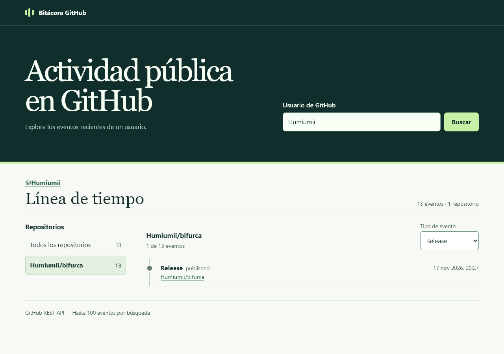

# Bitácora GitHub

Visor de actividad pública reciente de GitHub con una CLI en Python y una demo estática en React, TypeScript y Vite. Inspirado en [GitHub User Activity de roadmap.sh](https://roadmap.sh/projects/github-user-activity).



## CLI

Requiere Python 3.10 o superior y usa la biblioteca estándar. Desde la raíz del repositorio:

```sh
python github_activity.py Humiumii
python -m unittest -v
```

Cada fila muestra la fecha en UTC, el tipo de evento y el repositorio. Los pushes, pull requests, issues y comentarios en issues aparecen primero. Cada grupo se ordena del evento más nuevo al más antiguo. La CLI devuelve código 1 si falla la consulta y código 0 si GitHub responde con una lista vacía. Las pruebas simulan las respuestas HTTP y los fallos de red.

## Demo web

Requiere Node.js 20.19+ en la rama 20, o 22.12+.

```sh
cd web
npm ci
npm run dev
```

Abre la URL que imprime Vite y pulsa **Buscar** con el usuario de ejemplo, `Humiumii`. Selecciona un repositorio para abrir su línea de tiempo y elige **Tipo de evento** para filtrar. Las fechas se muestran en la zona horaria del navegador.

Para compilar y probar el sitio estático:

```sh
npm run build
npm run preview
```

Publica el contenido de `web/dist/` en cualquier alojamiento estático. En GitHub Pages puedes subir esa carpeta como el artefacto del sitio desde un workflow con Pages configurado para GitHub Actions. Vite genera rutas relativas para que los recursos carguen también bajo el subdirectorio del repositorio.

## Alcance de la API

- Cada búsqueda carga una página de hasta 100 eventos desde `GET /users/{username}/events/public`. El repositorio seleccionado y el tipo de evento filtran esa página en el navegador. [Endpoint de eventos públicos de un usuario](https://docs.github.com/en/rest/activity/events#list-public-events-for-a-user)
- GitHub limita la línea de tiempo a 300 eventos de los últimos 30 días y documenta una latencia de 30 segundos a 6 horas. El feed contiene eventos públicos y puede tardar en reflejar acciones recientes. [Documentación de eventos](https://docs.github.com/en/rest/activity/events)
- El navegador consulta la API directamente mediante CORS. La cuota primaria sin autenticación es de 60 solicitudes por hora por IP y GitHub también puede aplicar límites secundarios. La demo funciona sin servidor propio ni token. [CORS](https://docs.github.com/en/rest/using-the-rest-api/using-cors-and-jsonp-to-make-cross-origin-requests) · [Límites de la API REST](https://docs.github.com/en/rest/using-the-rest-api/rate-limits-for-the-rest-api)

## Publicar el repositorio

Crea un repositorio vacío en GitHub y conecta su URL desde la raíz de este proyecto.

```sh
git remote add origin https://github.com/Humiumii/github-activity.git
git push -u origin main
git push origin v0.1.0
```
